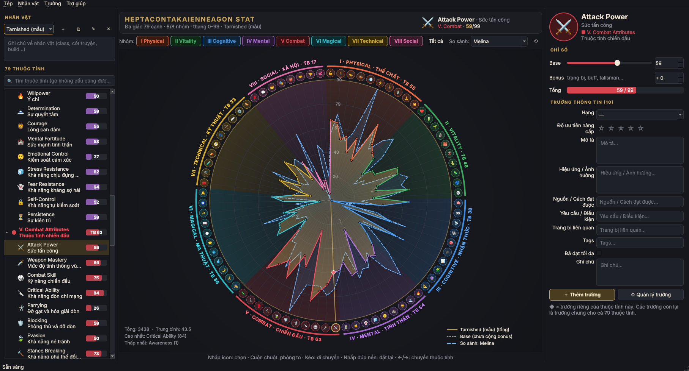
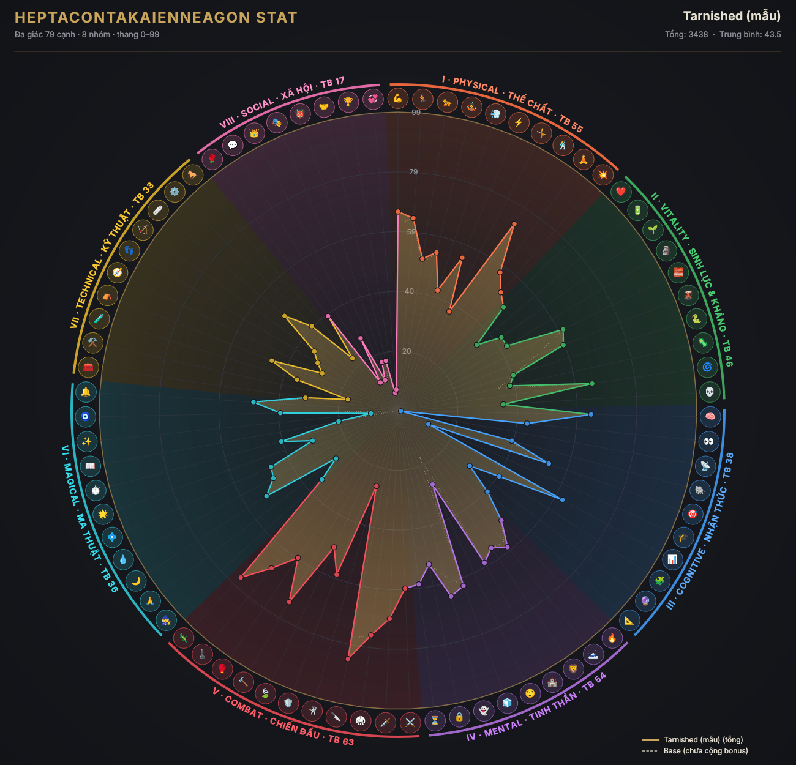

# Heptacontakaienneagon Stat

Biểu đồ radar **79 cạnh** (hepta·conta·kai·ennea·gon = 70 + 9) cho *Hệ thống thuộc tính và năng lực nhân vật toàn diện*: **8 nhóm, 79 thuộc tính**. Giống "hexagon stat" nhưng có 79 trục thay vì 6.



*Ảnh: Tarnished (tối đa, vùng vàng) so sánh với một nhân vật khác (đường nét đứt xanh).*

## Bắt đầu nhanh

Chọn **một** trong ba cách.

### Cách 1: Tải file .exe (Windows, không cần cài gì)

1. Tải file **[HeptacontakaienneagonStat.exe](https://github.com/jerrynguy/heptacontakaienneagon-stat1/raw/main/download/HeptacontakaienneagonStat.exe)** (~28 MB). Bấm vào link là tải về luôn. File cũng nằm trong thư mục [`download/`](download/) của repo.
2. Bấm đúp vào file vừa tải.
3. Nếu Windows báo *"Windows protected your PC"*, bấm **More info → Run anyway**. Cảnh báo này xuất hiện vì exe chưa được ký số.

Yêu cầu: **Windows 10 (bản 1903 trở lên) hoặc Windows 11, 64-bit**. Mỗi lần mở mất vài giây, vì exe phải tự giải nén trước khi chạy.

### Cách 2: Chạy từ mã nguồn (Windows, macOS, Linux)

1. Cài **Python 3.10 trở lên** từ [python.org](https://www.python.org/downloads/). Trên Windows, nhớ tích ô **Add python.exe to PATH** khi cài.
2. Lấy mã nguồn bằng một trong hai cách:
   - Bấm nút xanh **Code → Download ZIP** ở đầu trang này rồi giải nén, **hoặc**
   - dùng git:
     ```bash
     git clone https://github.com/jerrynguy/heptacontakaienneagon-stat1.git
     ```
3. Mở Terminal (Windows: *Command Prompt* hoặc *PowerShell*) trong thư mục vừa tải về rồi chạy:
   ```bash
   python -m pip install -r requirements.txt
   ```
   ```bash
   python run.py
   ```
   Nếu muốn mở thẳng một file đã lưu: `python run.py ten_file.hstat.json`.

### Cách 3: Tự build file .exe (sau khi sửa code)

Mỗi lần bạn push code lên `main`, **GitHub Actions tự build và chạy thử exe trên Windows**. Bản build nằm ở tab **Actions → lần chạy mới nhất → mục Artifacts**. Muốn tự build trên máy mình thì làm như sau:


1. Làm bước 1 và 2 của Cách 2 trên một máy Windows.
2. Bấm đúp **`build_windows.bat`**. Script tự cài PyInstaller rồi đóng gói theo `hstat.spec`.
3. File mới nằm ở `dist\HeptacontakaienneagonStat.exe`. Chạy thử nhanh: `powershell -ExecutionPolicy Bypass -File packaging\smoke_test.ps1 -Exe dist\HeptacontakaienneagonStat.exe` (mở app 5 lần, kiểm tra không bị tắt đột ngột). Muốn cập nhật bản cho người khác tải thì chép file đó đè lên `download\HeptacontakaienneagonStat.exe`.

## Hướng dẫn sử dụng

1. **Chọn thuộc tính**: nhấp vào một icon quanh biểu đồ, hoặc chọn trong danh sách bên trái. Ô tìm kiếm gõ không dấu cũng được. Rê chuột lên icon hoặc tên thuộc tính để đọc nhanh định nghĩa.
2. **Nhập chỉ số**: ở panel bên phải, kéo thanh **Base** và nhập **Bonus** (trang bị, buff). Biểu đồ cập nhật ngay.
3. **Điền thông tin**: đọc khối **Định nghĩa** ở đầu panel phải (bấm ✎ để sửa, ↺ để khôi phục bản gốc), rồi điền các trường bên dưới (Hạng, Hiệu ứng, Ghi chú…).
4. **Thêm trường**: bấm **＋ Thêm trường**. Chọn *trường chung* nếu muốn trường xuất hiện ở cả 79 thuộc tính, hoặc *trường riêng* nếu chỉ thuộc tính này có.
5. **Đổi icon**: bấm vào icon tròn lớn ở panel phải để chọn emoji khác hoặc ảnh từ máy.
6. **Xem theo nhóm**: bấm các nút **I Physical … VIII Social** để bật hoặc tắt từng nhóm. Chuột phải vào một nút để chỉ xem nhóm đó.
7. **Nhiều nhân vật**: dùng các nút ＋ ⧉ ✎ ✕ ở góc trên bên trái để thêm, nhân bản, đổi tên, xóa. Ô **So sánh** cho phép chồng hai nhân vật lên nhau.
8. **Lưu**: Ctrl+S lưu thành file `.hstat.json`. Lần sau mở app, file gần nhất tự mở lại.
9. **Xuất**: Ctrl+E xuất ảnh PNG, Ctrl+Shift+E xuất bảng CSV mở được bằng Excel.

Trên biểu đồ: cuộn chuột để phóng to, kéo để di chuyển, nhấp đúp vào nền để đặt lại, phím ←/→ để chuyển thuộc tính.

## Tính năng

**Biểu đồ**
- Đa giác 79 cạnh vẽ bằng QPainter. Mỗi nhóm có màu riêng, tên nhóm uốn cong theo vòng cung và hiện điểm trung bình (TB).
- Mỗi trục có một icon. Nhấp vào icon để chọn thuộc tính, rê chuột để xem nhanh.
- Cuộn chuột để phóng to (quanh vị trí con trỏ), kéo để di chuyển, nhấp đúp nền để đặt lại. Phím ←/→ chuyển thuộc tính, `+`/`-`/`0` để zoom.
- Lọc nhóm: tắt bớt nhóm thì đa giác tự đổi số cạnh và đổi tên (chỉ nhóm I → *decagon*, chỉ nhóm VI → *hendecagon*…). Chuột phải vào một nhóm để chỉ xem nhóm đó.
- Đường chấm là lớp *Base*, vùng tô là *Tổng = Base + Bonus*. Có thể chồng thêm một nhân vật khác để **so sánh** (đường nét đứt màu xanh).
- Xuất ảnh PNG độ phân giải cao (Ctrl+E):



**Mỗi thuộc tính có**
- **Định nghĩa** có sẵn: một đoạn mô tả chính xác thuộc tính đó là gì, dùng chung cho mọi nhân vật. Sửa được ngay trong app (lưu kèm dự án) và có cột riêng khi xuất CSV.
- **Icon**: emoji có sẵn. Bấm vào icon lớn ở panel phải để đổi sang emoji khác hoặc **ảnh từ máy**. Ảnh được nhúng base64 vào file dự án nên mang đi máy khác vẫn còn.
- **Base** (thanh trượt và ô số), **Bonus** (trang bị/buff), **Tổng** (tự giới hạn trong thang điểm, mặc định **0–999**; đổi ở **Trường → Thang điểm tối đa**). Nhân vật mới bắt đầu ở 100 cho mọi chỉ số.
- **Không giới hạn số trường**, có 6 kiểu: văn bản ngắn, đoạn văn, số, Có/Không, danh sách chọn, đánh giá ★.
  - *Trường chung*: áp dụng cho cả 79 thuộc tính. Có sẵn 9 trường: Hạng, Độ ưu tiên, Hiệu ứng, Nguồn, Yêu cầu, Trang bị, Tags, Đã tối đa, Ghi chú. Thêm, sửa, xóa, sắp xếp bằng **Trường → Quản lý trường chung** (Ctrl+M).
  - *Trường riêng* (◆): chỉ thuộc tính đó có.

**Khác**
- Nhân vật mẫu *Tarnished* đạt tối đa ở mọi thứ: 999 ở cả 79 chỉ số, hạng S.
- Nhiều nhân vật trong một dự án: thêm, nhân bản, đổi tên, xóa, ghi chú nhân vật.
- Tìm thuộc tính không cần gõ dấu ("suc manh" vẫn tìm ra "Sức mạnh").
- Đặt Base hàng loạt hoặc ngẫu nhiên cho các nhóm đang hiển thị, xóa toàn bộ Bonus.
- Lưu/mở file `.hstat.json` (UTF-8, đọc được bằng mắt). App tự mở lại file gần nhất.
- File lưu từ bản cũ (thang 0–99) tự được nâng lên thang 0–999 khi mở: mọi chỉ số quy đổi theo tỷ lệ (99 → 999) nên hình biểu đồ giữ nguyên, trường "Mô tả" còn trống được bỏ vì đã có Định nghĩa. App báo rõ những gì đã đổi; bấm Ctrl+S để lưu lại. File có thang tự chọn khác 99 được giữ nguyên.
- Xuất CSV mở được bằng Excel, không lỗi font tiếng Việt (Ctrl+Shift+E).

## Cấu trúc

```
hstat/
  attributes.py     8 nhóm + 79 thuộc tính (tên EN/VI, icon, màu)
  descriptions.py   định nghĩa có sẵn của 79 thuộc tính
  polygon_names.py  tên Hy Lạp của đa giác n cạnh (79 → heptacontakaienneagon)
  model.py          Project → Character → StatEntry → FieldDef; lưu/mở JSON, xuất CSV
  chart.py          widget biểu đồ radar N cạnh (vẽ, hit-test, zoom/pan, xuất PNG)
  editor.py         panel sửa thuộc tính + tạo widget động theo kiểu trường
  dialogs.py        hộp thoại thêm/sửa/quản lý trường, chọn icon
  main_window.py    cửa sổ chính, menu, đồng bộ cây ↔ biểu đồ ↔ panel
  theme.py          giao diện tối tông vàng kim
  assets/           icon ứng dụng (app.ico, app.png)
tests/test_core.py  kiểm thử phần lõi (python -m pytest tests)

hstat.spec                 cấu hình PyInstaller để đóng gói exe
packaging/version_info.txt thông tin phiên bản hiển thị trong Properties của exe
build_windows.bat          build exe trên Windows bằng một cú bấm đúp
requirements-build.txt     thư viện cần để build
packaging/smoke_test.ps1   chạy thử exe nhiều lần, kiểm tra không bị crash
.github/workflows/         GitHub Actions: tự build và chạy thử exe trên Windows
tools_make_icon.py         vẽ lại icon ứng dụng
download/                  file .exe build sẵn để tải về
```

Chạy kiểm thử: `pip install pytest` rồi `python -m pytest tests`.

**Đổi hoặc thêm thuộc tính**: sửa danh sách `_RAW` trong `hstat/attributes.py` rồi bỏ hoặc sửa các dòng `assert` kiểm tra con số 79 ở cuối file. Biểu đồ, tên đa giác và cây thuộc tính tự cập nhật theo số lượng mới.
